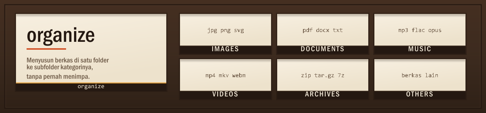
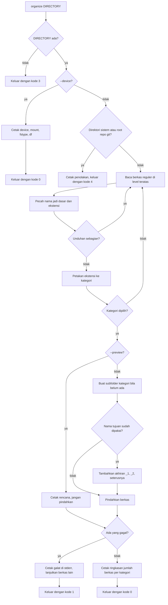

<p align="center">
  
</p>

<p align="center">
  <a href="https://github.com/Ivanadrian31/organize/releases/latest"></a>
  <a href="https://github.com/Ivanadrian31/organize/actions/workflows/ci.yml"></a>
  
  
  <a href="LICENSE"></a>
</p>

<p align="center"><b>Menyusun berkas di satu folder ke subfolder kategorinya, tanpa pernah menimpa berkas yang sudah ada.</b></p>

<p align="center">Paket <code>.deb</code> untuk Ubuntu 22.04 dan 24.04, tanpa dependensi di luar paket dasar.</p>

<p align="center">
  <a href="#fitur">Fitur</a> ·
  <a href="#instalasi">Instalasi</a> ·
  <a href="#penggunaan">Penggunaan</a> ·
  <a href="#cara-kerja">Cara kerja</a> ·
  <a href="#troubleshooting">Troubleshooting</a> ·
  <a href="#lisensi">Lisensi</a> ·
  <a href="docs/CONTRIBUTING.md">Kontribusi</a>
</p>

---

## Fitur

- Tidak pernah menimpa berkas. Kalau nama tujuan sudah dipakai, program memakai nama berikutnya yang kosong: `photo.jpg` menjadi `photo_1.jpg`, lalu `photo_2.jpg`. Ekstensi majemuk tetap utuh, jadi `backup.tar.gz` menjadi `backup_1.tar.gz`.
- Tidak menyentuh apa pun di luar folder target. Subfolder, berkas tersembunyi, dan symlink dibiarkan apa adanya.
- Melewati unduhan yang belum selesai. Berkas `.part`, `.crdownload`, `.download`, `.tmp`, dan `.filepart` tidak pernah dipindahkan, karena pengunduh masih menulis ke berkas itu.
- Hanya memakai bash, `findmnt`, dan `df`, semuanya sudah ada di Ubuntu.

### Kategori dan ekstensi

| Folder | Ekstensi |
|---|---|
| `Images/` | jpg jpeg png gif bmp webp svg tif tiff heic avif |
| `Documents/` | pdf doc docx xls xlsx ppt pptx txt md rtf odt ods odp csv epub |
| `Music/` | mp3 wav flac aac ogg m4a opus wma |
| `Videos/` | mp4 mkv avi mov webm m4v wmv flv |
| `Archives/` | zip rar 7z tar gz bz2 xz tgz iso |
| `Others/` | semua berkas lain, termasuk berkas tanpa ekstensi |

---

## Instalasi

### Paket Debian

Unduh `organize_0.2.0_all.deb` dari
[rilis terbaru](https://github.com/Ivanadrian31/organize/releases/latest), lalu:

```sh
sudo apt install ./organize_0.2.0_all.deb
```

Paket ini memasang `/usr/bin/organize`, pembungkus `/usr/bin/organize-dl`, man
page ke `/usr/share/man`, dan completion bash ke
`/usr/share/bash-completion/completions`.

Copot dengan `sudo apt remove organize`.

### Memperbarui dari 0.1.0

Paket 0.2.0 bernama `organize` dan menyatakan `Replaces` serta `Conflicts`
terhadap `organize-dl`, jadi memasangnya mencabut paket lama secara otomatis.
Tidak perlu mencopot `organize-dl` lebih dulu.

```sh
sudo apt install ./organize_0.2.0_all.deb
```

Perintahnya berubah dari `organize-dl` menjadi `organize`. Nama lama tetap
bekerja sebagai pembungkus yang mencetak peringatan.

### Dari source

```sh
git clone https://github.com/Ivanadrian31/organize.git
cd organize
sudo make install
```

`sudo make install` menaruh berkas di `/usr/local`. Tanpa sudo:

```sh
make install PREFIX="$HOME/.local"
```

`sudo make uninstall` menghapus berkas yang terpasang.

---

## Penggunaan

```
organize [OPTIONS] [DIRECTORY]

  -p, --preview   print the plan without moving anything
  --images        only handle Images
  --documents     only handle Documents
  --music         only handle Music
  --videos        only handle Videos
  --archives      only handle Archives
  --others        only handle Others
  --device        show the storage device, filesystem and free space of DIRECTORY
  -h, --help      show this help and exit
  -V, --version   show the version and exit
  --              end of options; use before a DIRECTORY starting with '-'
```

Opsi harus ditulis sebelum `DIRECTORY`. Tanpa `DIRECTORY`, targetnya direktori
kerja saat ini. Tanpa flag kategori, keenam kategori diproses.

| Kode keluar | Arti |
|---|---|
| `0` | semua berkas berhasil dipindahkan, atau memang tidak ada yang perlu dipindahkan |
| `1` | ada berkas yang gagal dipindahkan; berkas lain tetap diproses |
| `2` | opsi atau argumen tidak valid |
| `3` | `DIRECTORY` tidak ada atau bukan direktori |
| `4` | `DIRECTORY` adalah direktori sistem atau root repo git |

### Menyusun folder yang sedang dibuka

```sh
organize
```

Contoh di bawah dijalankan sungguhan. `Documents/invoice.pdf` dan
`Archives/backup.tar.gz` sudah ada sebelumnya, jadi kedua berkas baru disimpan
dengan akhiran `_1`:

```
backup.tar.gz -> Archives/backup_1.tar.gz
clip.mp4 -> Videos/clip.mp4
draft.xyz -> Others/draft.xyz
holiday.jpg -> Images/holiday.jpg
invoice.pdf -> Documents/invoice_1.pdf
notes -> Others/notes
report.pdf -> Documents/report.pdf
track.mp3 -> Music/track.mp3
Moved 8 files: Images 1, Documents 2, Music 1, Videos 1, Archives 1, Others 2.
```

### Melihat rencana lebih dulu

```sh
organize --preview /path/ke/folder
```

```
[preview] holiday.jpg -> Images/holiday.jpg
[preview] invoice.pdf -> Documents/invoice.pdf
[preview] track.mp3 -> Music/track.mp3
3 files would be moved: Images 1, Documents 1, Music 1.
```

### Satu kategori saja, atau folder lain

```sh
organize --images
organize --documents --archives ~/Tugas
organize ~/Tugas
organize -- -incoming
```

Kategori lain tidak disentuh. Baris terakhir memakai `--` untuk folder yang
namanya diawali tanda hubung.

### Melihat perangkat penyimpanan

```sh
organize --device ~/Downloads
```

```
device: /dev/sdd[/data/docker/volumes/organize-audit/_data]
mount: /root/Downloads
fstype: ext4
Filesystem      Size  Used Avail Use% Mounted on
/dev/sdd       1007G   11G  945G   2% /root/Downloads
```

### Folder yang ditolak

Direktori sistem dan root repo git ditolak sebelum ada berkas yang dipindahkan:

```
organize: refusing to work on "/etc": it is a system directory
organize: refusing to work on "/home/bima/proyek": it is the root of a git repository
```

Program membandingkan path setelah symlink diselesaikan, jadi `$HOME` ditolak
tetapi `$HOME/Downloads` tetap boleh, dan subfolder di dalam repo juga tetap
boleh.

---

## Cara kerja

`organize` membaca isi direktori target, memetakan tiap nama berkas ke satu
kategori, lalu memindahkannya ke subfolder kategori itu.



Program membaca berkas dalam urutan byte nama, jadi isi folder yang sama
menghasilkan urutan yang sama.

---

## Troubleshooting

| Masalah | Solusi |
|---|---|
| `organize: command not found` | Paket belum terpasang. Pasang berkas `.deb` terbaru dari halaman rilis, atau tambahkan `/usr/local/bin` ke `PATH`. |
| `organize: directory "..." not found` | Folder target tidak ada atau bukan direktori. Cek jalurnya; kode keluar untuk kondisi ini adalah `3`. |
| `organize: refusing to work on "..."` | Folder itu direktori sistem atau root repo git. Pindah ke subfolder yang ingin dirapikan, atau sebutkan folder lain sebagai `DIRECTORY`. Kode keluarnya `4`. |
| `organize: option "--dry-run" is now --preview` | Pakai `--preview` atau `-p`. Pembungkus `organize-dl` masih menerjemahkan `--dry-run`. |
| `organize: unknown option "..."` | Opsi harus ditulis sebelum `DIRECTORY`. Untuk folder yang namanya diawali `-`, pakai `organize -- -namafolder`. |
| `organize: cannot move "..."` | Berkas tidak bisa dipindahkan, mungkin karena permission atau berkas sedang dipakai. Berkas lain tetap diproses, dan kode keluar menjadi `1`. |
| `organize: cannot create directory "..."` | Subfolder kategori tidak bisa dibuat. Periksa permission folder target. |

---

## Lisensi

MIT, lihat [LICENSE](LICENSE).

Cara menyumbang kode, menjalankan pemeriksaan, dan merilis versi baru ada di
[docs/CONTRIBUTING.md](docs/CONTRIBUTING.md).
