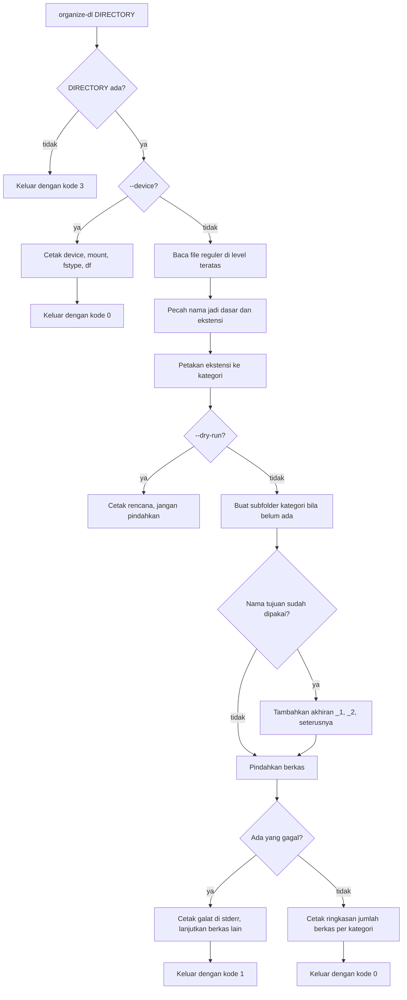

<p align="center">
  
</p>

<p align="center">
  <a href="https://github.com/Ivanadrian31/organize/releases/latest"></a>
  <a href="https://github.com/Ivanadrian31/organize/actions/workflows/ci.yml"></a>
  
  
  <a href="LICENSE"></a>
</p>

<p align="center"><b>Menyusun file di folder Downloads ke subfolder kategorinya, tanpa pernah menimpa berkas yang sudah ada.</b></p>

<p align="center">Skrip bash untuk Ubuntu 22.04 dan 24.04, distribusi Debian, tanpa dependensi baru.</p>

<p align="center">
  <a href="#fitur">Fitur</a> ·
  <a href="#instalasi">Instalasi</a> ·
  <a href="#penggunaan">Penggunaan</a> ·
  <a href="#cara-kerja">Cara kerja</a> ·
  <a href="#pengembangan">Pengembangan</a> ·
  <a href="#rilis">Rilis</a> ·
  <a href="#troubleshooting">Troubleshooting</a> ·
  <a href="#kontributor">Kontributor</a> ·
  <a href="#lisensi">Lisensi</a>
</p>

---

## Fitur

- **Menyusun berdasarkan ekstensi.** Setiap file reguler di level teratas folder dipindah ke `Images/`, `Documents/`, `Music/`, `Videos/`, `Archives/`, atau `Others/` sesuai ekstensinya.
- **Tidak pernah menimpa.** Kalau nama berkas sudah ada di subfolder tujuan, program memakai nama berikutnya yang kosong: `photo.jpg` menjadi `photo_1.jpg`, lalu `photo_2.jpg`. Ekstensi majemuk tetap utuh, jadi `backup.tar.gz` menjadi `backup_1.tar.gz`, bukan `backup.tar_1.gz`.
- **Tidak menyentuh apa pun di luar folder target.** Subfolder, file tersembunyi, dan symlink dibiarkan apa adanya.
- **Folder dibuat sesuai kebutuhan.** Folder yang hanya berisi gambar berakhir dengan satu subfolder `Images/`, bukan enam folder kosong.
- **Pratinjau dulu.** `--dry-run` menampilkan rencana tanpa memindahkan satu file pun.
- **Melihat perangkat penyimpanan.** `--device` melaporkan block device, mount point, filesystem, dan ruang kosong di belakang folder target, lalu berhenti tanpa memindahkan file.
- **Tanpa dependensi baru.** Hanya bash, `findmnt`, dan `df` dari paket yang sudah ada di Ubuntu.

### Kategori dan ekstensi

| Folder | Ekstensi |
|---|---|
| `Images/` | jpg jpeg png gif bmp webp svg tif tiff heic avif |
| `Documents/` | pdf doc docx xls xlsx ppt pptx txt md rtf odt ods odp csv epub |
| `Music/` | mp3 wav flac aac ogg m4a opus wma |
| `Videos/` | mp4 mkv avi mov webm m4v wmv flv |
| `Archives/` | zip rar 7z tar gz bz2 xz tgz iso |
| `Others/` | semua berkas lain, termasuk berkas tanpa ekstensi |

---

## Instalasi

### Paket Debian (Ubuntu 22.04 dan 24.04)

Unduh `organize-dl_0.1.0_all.deb` dari
[rilis terbaru](https://github.com/Ivanadrian31/organize/releases/latest), lalu:

```sh
sudo apt install ./organize-dl_0.1.0_all.deb
```

Paket ini memasang biner ke `/usr/bin`, man page ke `/usr/share/man`, dan
completion bash ke `/usr/share/bash-completion/completions`.

Copot dengan `sudo apt remove organize-dl`.

### Dari source

```sh
git clone https://github.com/Ivanadrian31/organize.git
cd organize
sudo make install
```

`sudo make install` menaruh berkas di `/usr/local`. Tanpa sudo:

```sh
make install PREFIX="$HOME/.local"
```

`sudo make uninstall` menghapus berkas yang terpasang.

---

## Penggunaan

```
organize-dl [OPTIONS] [DIRECTORY]

  -n, --dry-run   print the plan without moving anything
  -h, --help      show help
  -V, --version   show the version
  --device        show the storage device, filesystem and free space
  --              end of options; use before a DIRECTORY starting with '-'
```

Opsi harus ditulis sebelum `DIRECTORY`. Tanpa `DIRECTORY`, targetnya `~/Downloads`.

| Kode keluar | Arti |
|---|---|
| `0` | semua berkas berhasil dipindahkan, atau memang tidak ada yang perlu dipindahkan |
| `1` | ada berkas yang gagal dipindahkan; berkas lain tetap diproses |
| `2` | opsi atau argumen tidak valid |
| `3` | `DIRECTORY` tidak ada atau bukan direktori |

### Menyusun folder Downloads

```sh
organize-dl
```

Contoh keluaran dari run nyata, dengan `Documents/invoice.pdf` yang sudah ada
sebelumnya sehingga berkas baru disimpan sebagai `invoice_1.pdf`:

```
backup.tar.gz -> Archives/backup.tar.gz
clip.mp4 -> Videos/clip.mp4
draft.xyz -> Others/draft.xyz
holiday.jpg -> Images/holiday.jpg
invoice.pdf -> Documents/invoice_1.pdf
notes -> Others/notes
track.mp3 -> Music/track.mp3
Moved 7 files: Images 1, Documents 1, Music 1, Videos 1, Archives 1, Others 2.
```

Kalau `Archives/backup.tar.gz` sudah ada, ekstensinya tetap utuh:

```
backup.tar.gz -> Archives/backup_1.tar.gz
Moved 1 file: Archives 1.
```

### Melihat rencana lebih dulu

```sh
organize-dl --dry-run /path/ke/folder
```

```
[dry-run] holiday.jpg -> Images/holiday.jpg
[dry-run] invoice.pdf -> Documents/invoice.pdf
[dry-run] track.mp3 -> Music/track.mp3
3 files would be moved: Images 1, Documents 1, Music 1.
```

### Folder lain

```sh
organize-dl ~/Tugas
organize-dl -- -incoming
```

### Melihat perangkat penyimpanan

```sh
organize-dl --device ~/Downloads
```

Keluaran di bawah ini diambil dari container Linux di atas block device ext4
sungguhan, bukan dari filesystem container:

```
device: /dev/sdd[/data/docker/volumes/organize-readme-demo/_data]
mount: /root/Downloads
fstype: ext4
Filesystem      Size  Used Avail Use% Mounted on
/dev/sdd       1007G   11G  945G   2% /root/Downloads
```

Folder target yang tidak ada menghasilkan pesan galat dan kode keluar `3`:

```
organize-dl: directory "/root/TidakAda" not found
```

---

## Cara kerja

`organize-dl` membaca isi direktori target, memetakan tiap nama berkas ke satu
kategori, lalu memindahkannya ke subfolder kategori itu.



Berkas diproses menurut urutan byte nama berkasnya, sehingga run dengan isi folder
yang sama selalu menghasilkan hasil yang sama.

---

## Pengembangan

Semua pemeriksaan berjalan di dalam Docker, jadi mesin pembuat hanya butuh
Docker.

| Perintah | Yang dikerjakan |
|---|---|
| `make versi` | memastikan versi di empat tempat sama |
| `make check` | shellcheck pada severity style, lalu seluruh test bats |
| `make man` | membangun man page tanpa peringatan |
| `make deb` | membangun `dist/organize-dl_0.1.0_all.deb` |
| `make lint` | menjalankan lintian pada paket yang dibangun |
| `make uji-pasang` | memasang paket di container Ubuntu yang bersih lalu mengujinya |

Gate lengkap, di dua rilis Ubuntu yang didukung:

```sh
docker run --rm -v "$(cygpath -m "$PWD"):/src" -w /src ubuntu:24.04 bash -c \
  'apt-get update -qq >/dev/null 2>&1 && apt-get install -y -qq bats shellcheck make groff-base lintian dpkg-dev >/dev/null 2>&1 && chmod +x bin/organize-dl tests/pasang-bersih.sh && make versi check man deb lint'

docker run --rm -v "$(cygpath -m "$PWD"):/src" -w /src ubuntu:22.04 bash -c \
  'apt-get update -qq >/dev/null 2>&1 && apt-get install -y -qq bats shellcheck make groff-base lintian dpkg-dev >/dev/null 2>&1 && chmod +x bin/organize-dl tests/pasang-bersih.sh && make versi check man deb lint'

bash tests/pasang-bersih.sh
```

Di Linux, `$(cygpath -m "$PWD")` tidak diperlukan dan cukup menulis
`-v "$PWD:/src"`.

Test bats ada di `tests/organize.bats`, helper-nya di `tests/helper.bash`, dan
test pemasangan bersih di `tests/pasang-bersih.sh`.

---

## Rilis

Versi hidup di empat tempat dan harus selalu sama: `VERSION` di `Makefile`,
`VERSION` di `bin/organize-dl`, `Version:` di `debian/control`, dan baris
pertama `debian/changelog`. `make versi` memeriksa keempatnya.

Rilis dimulai dari tag beranotasi:

```sh
git tag -a v0.1.0 -m "v0.1.0"
git push origin v0.1.0
```

Workflow `release` membangun paket di `ubuntu-22.04` lalu menempelkannya ke
rilis GitHub yang baru.

---

## Troubleshooting

| Masalah | Solusi |
|---|---|
| `organize-dl: command not found` | Paket belum terpasang. Jalankan `sudo apt install ./organize-dl_0.1.0_all.deb`, atau tambahkan `/usr/local/bin` ke `PATH`. |
| `organize-dl: directory "..." not found` | Folder target tidak ada atau bukan direktori. Cek jalurnya; kode keluar untuk kondisi ini adalah `3`. |
| `organize-dl: unknown option "..."` | Opsi harus ditulis sebelum `DIRECTORY`. Untuk folder yang namanya diawali `-`, pakai `organize-dl -- -namafolder`. |
| `organize-dl: cannot move "..."` | Berkas tidak bisa dipindahkan, mungkin karena permission atau berkas sedang dipakai. Pesan galat ditulis ke stderr, berkas lain tetap diproses, dan kode keluar menjadi `1`. |
| `organize-dl: cannot create directory "..."` | Subfolder kategori tidak bisa dibuat. Periksa permission folder target. |
| Some files were not moved, dan exit code 1 | Setidaknya satu berkas gagal dipindahkan, sisanya tetap diproses. Baca pesan galat di stderr untuk nama berkasnya. |
| `--device` menampilkan `overlay` | Output itu berasal dari filesystem container, bukan disk yang sebenarnya. Jalankan flag ini di mesin yang memegang berkasnya. |
| Nama berkas mendapat akhiran angka | Nama itu sudah dipakai di subfolder tujuan, jadi program memilih nama berikutnya yang kosong. |
| Completion bash tidak aktif | completion terpasang di `/usr/share/bash-completion/completions`. Muat ulang shell, atau jalankan `source /usr/share/bash-completion/completions/organize-dl`. |
| `make versi` gagal | Versi di empat tempat tidak sama. Jalankan `make versi` untuk melihat nilai masing-masing tempat. |

---

## Kontributor

| Nama | GitHub |
|---|---|
| Ivan Adrian Bhagaskara | [@Ivanadrian31](https://github.com/Ivanadrian31) |
| Bima Adji Kusuma | [@bimadji](https://github.com/bimadji) |

---

## Lisensi

MIT, lihat [LICENSE](LICENSE).
